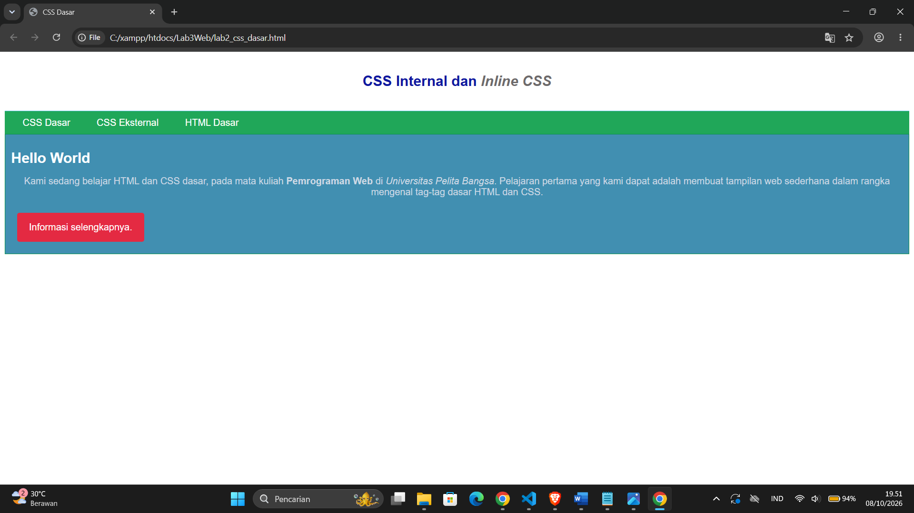

# Lab3Web — Praktikum 3: CSS Dasar

## Identitas
- **Nama:** Rizki Dwi Ananta
- **NIM:** 312510369
- **Kelas:** I251D
- **Mata Kuliah:** Pemrograman Web

## Deskripsi
Praktikum CSS Dasar yang mencakup konsep dasar CSS, aturan penulisan (Internal, Eksternal, Inline), dan selector (Elemen, Class, ID).

## Struktur Folder
Lab3Web/
├── lab2_css_dasar.html
├── style_eksternal.css
├── screenshot/
│ ├── 1_html_dasar.png
│ ├── 2_css_internal.png
│ ├── 3_inline_css.png
│ ├── 4_css_eksternal.png
│ └── 5_css_selector.png
└── README.md

---

## Langkah Praktikum

### 1. Membuat Dokumen HTML Dasar
Membuat file `lab2_css_dasar.html` dengan struktur HTML murni (header, nav, div#intro) tanpa CSS.

---

### 2. Menambahkan CSS Internal
Menambahkan tag `<style>` di dalam `<head>` untuk mengatur `body`, `header`, `h1`, dan `h1 i`.

---

### 3. Menambahkan Inline CSS
Menambahkan atribut `style` pada tag `
` untuk mengatur `text-align: center` dan `color: #ccd8e4`.

---

### 4. Membuat CSS Eksternal
Membuat file `style_eksternal.css` dan menghubungkannya via `<link rel="stylesheet">`.

---

### 5. Menambahkan CSS Selector (ID & Class)
- **ID Selector (`#intro`)** — mengatur elemen dengan `id="intro"`
- **Class Selector (`.button`, `.btn-primary`)** — mengatur elemen dengan `class="button btn-primary"`

---
